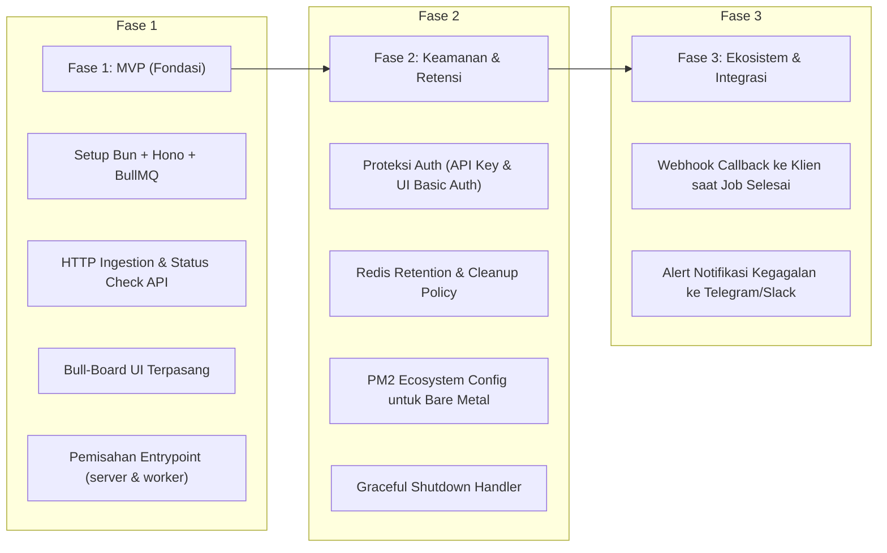

# Product Requirement Document (PRD)
# Qentral — Centralized Job Processing Engine

| Atribut | Nilai |
| :--- | :--- |
| **Nama Produk** | **Qentral** |
| **Versi Dokumen** | 1.0 (Draft) |
| **Target Runtime** | Bun (TypeScript), Hono, BullMQ, Redis |
| **Status** | Approved |
| **Pemilik / Penanggung Jawab** | Backend & Platform Team |

---

## 1. Latar Belakang & Pernyataan Masalah

### 1.1 Masalah Saat Ini
1. **Beban pada API Utama**: Tugas-tugas berat di latar belakang (seperti render PDF, ekspor data ribuan baris, pengiriman blast email) sering kali dijalankan di dalam server API yang sama dengan tempat user berinteraksi, berisiko menyebabkan *event loop freeze* dan API timeout.
2. **Kurangnya Visibilitas**: Tidak adanya dashboard terpadu untuk memantau status pekerjaan (*waiting*, *active*, *completed*, *failed*), sehingga tim teknis kesulitan menelusuri pekerjaan yang macet atau gagal.
3. **Duplikasi Worker di Berbagai Service**: Setiap layanan mikro (*microservice*) membuat mekanisme antrean dan worker-nya sendiri-sendiri, mengakibatkan inkonsistensi penanganan error dan pemborosan resource server.

### 1.2 Solusi
Membangun satu sistem terpusat (**Modular Monolith**) yang berjalan di atas runtime **Bun** dengan dua proses runtime independen:
* **HTTP API Gateway & Bull-Board Dashboard**: Sebagai pintu gerbang penerimaan job dari layanan luar dan antarmuka monitoring visual.
* **Dedicated Worker Engine**: Sebagai eksekutor tugas latar belakang terisolasi yang dapat di-scale sesuai beban CPU.

---

## 2. Tujuan & Sasaran Produk (Goals & Objectives)

### 2.1 Sasaran Utama
* **Sentralisasi Pemicuan & Eksekusi**: Menjadi satu-satunya *entrypoint* dan pengelola *background task* untuk seluruh aplikasi internal.
* **Agnostik Bahasa Pemrograman**: Menyediakan antarmuka HTTP REST API agar layanan dari bahasa apa pun (PHP/Laravel, Python, Go, Frontend) dapat memicu job tanpa perlu mengerti protokol Redis/BullMQ.
* **Isolasi Beban & Stabilitas**: Memastikan kegagalan atau beban berat di sisi Worker tidak mengganggu server API publik.

### 2.2 Metrik Keberhasilan (KPI)
* **Ingestion Latency**: Respon penerimaan job via HTTP API `< 25ms`.
* **Zero Lost Jobs**: Tidak ada job yang terputus atau hilang saat server worker di-*restart* (*Graceful Shutdown*).
* **Observabilitas**: 100% status job dapat dipantau dan di-retry secara manual melalui dashboard Bull-Board.

---

## 3. Persona & Target Pengguna

1. **Aplikasi Klien / Layanan Eksternal (Producers)**:
   * Membutuhkan cara cepat untuk melempar pekerjaan asinkron dan mendapatkan `jobId` untuk pelacakan.
2. **Developer Aplikasi**:
   * Membutuhkan antarmuka koding yang rapi dan modular untuk menambahkan jenis antrean atau worker baru tanpa mengganggu kode yang sudah berjalan.
3. **DevOps & Administrator Sistem**:
   * Memerlukan akses aman ke dashboard untuk memeriksa antrean yang macet, melakukan *retry* massal, dan memantau penggunaan resource.

---

## 4. Kebutuhan Fungsional (Functional Requirements)

### FR-1: Job Ingestion API (Penerimaan Job via HTTP)
* Sistem **wajib** menyediakan endpoint `POST /api/v1/jobs/:queueName` untuk menerima pemicuan job dari luar.
* Sistem **wajib** memvalidasi keberadaan antrean (`queueName`). Jika antrean tidak terdaftar, kembalikan HTTP 404.
* Sistem **wajib** mengembalikan HTTP 202 (*Accepted*) beserta `jobId` segera setelah data berhasil ditulis ke Redis.
* Sistem **harus** mendukung opsi lanjutan pada request body: `delay` (tunda eksekusi), `priority`, dan `attempts` (jumlah retry).

### FR-2: Pelacakan Status Job (Job Status & Result Checking)
* Sistem **wajib** menyediakan endpoint `GET /api/v1/jobs/:queueName/:jobId`.
* Sistem **harus** mengembalikan informasi status job: `waiting`, `active`, `completed`, `failed`, atau `delayed`.
* Jika job sudah selesai (`completed`), kembalikan data *return value*. Jika gagal (`failed`), sertakan *failure reason / stack trace*.

### FR-3: Direct Ingestion via Redis (Untuk Service Internal)
* Sistem **wajib** mengekspor konfigurasi `Queue` yang kompatibel agar service internal sesama ekosistem Node.js/Bun dapat langsung mem-publish ke Redis tanpa melewati layer HTTP.

### FR-4: Manajemen Penjadwalan & Pengulangan (*Cron / Repeatable Jobs*)
* Sistem **harus** mendukung pendaftaran job berulang menggunakan format cron expression standar (misal: `0 0 * * *`).

### FR-5: Dashboard Pemantauan Visual (Bull-Board UI)
* Sistem **wajib** menyajikan dashboard visual Bull-Board pada path `/ui`.
* Dashboard **wajib** menampilkan seluruh antrean aktif beserta metrik: jumlah job aktif, selesai, gagal, tertunda, dan terjeda.
* Operator **dapat** melakukan aksi manual: *Retry Job Gagal*, *Hapus Job*, dan *Pause/Resume Antrean*.

### FR-6: Mekanisme Penanganan Kegagalan & Retry
* Setiap job gagal **wajib** mencoba ulang (*retry*) secara otomatis dengan strategi *exponential backoff* jika dikonfigurasikan.
* Job yang gagal setelah batas maksimal percobaan **wajib** dipindahkan ke status `failed` (Dead-Letter) untuk diaudit.

---

## 5. Kebutuhan Non-Fungsional (Non-Functional Requirements)

### NFR-1: Performa & Skalabilitas
* Runtime sistem menggunakan **Bun (v1.x)** untuk memaksimalkan efisiensi memory footprint dan kecepatan booting.
* Worker Engine **harus** dapat di-scale (*clustering*) menggunakan PM2 tanpa mengubah kode sumber.

### NFR-2: Keandalan & Integritas Data
* **Graceful Shutdown**: Saat menerima sinyal `SIGINT` atau `SIGTERM`, worker tidak boleh memutus koneksi Redis secara paksa sebelum menyelesaikan job yang sedang berjalan (*active*).
* **Idempotensi**: Sistem harus mendukung penetapan `jobId` khusus dari klien untuk mencegah pemicuan ganda (*duplicate execution*).

### NFR-3: Manajemen Memori Redis (Retention Policy)
* Untuk mencegah Redis kehabisan memori (OOM), sistem **wajib** menerapkan kebijakan pembersihan otomatis:
  * Job berstatus `completed`: Maksimal disimpan 1.000 riwayat terakhir atau usia maksimal 24 jam.
  * Job berstatus `failed`: Maksimal disimpan 5.000 riwayat terakhir atau usia maksimal 7 hari.

### NFR-4: Keamanan (Security)
* **Proteksi API**: Endpoint `POST /api/v1/jobs/*` dilindungi dengan validasi header API Key (`x-api-key`).
* **Proteksi Dashboard UI**: Endpoint `/ui` **wajib** dilindungi dengan Basic Authentication (Username & Password) agar tidak bisa diakses publik.

---

## 6. Batasan Sistem (*Out of Scope*)

Hal-hal berikut secara eksplisit **TIDAK** ditangani oleh proyek ini pada versi awal:
1. **Bukan Pengganti Event Streaming Skala Raksasa**: Sistem ini tidak ditujukan untuk *high-throughput event streaming* (seperti Apache Kafka untuk log ratusan ribu event per detik).
2. **Tidak Mengelola Database Utama**: Sistem ini hanya mengelola state antrean di Redis, bukan database transaksional permanen.
3. **Multi-Tenancy Dinamis**: Antrean baru didaftarkan secara statis melalui konfigurasi kode, bukan dibuat secara instan via API oleh sembarang user.

---

## 7. Rencana Fase Rilis (*Roadmap*)

---

## 8. Kriteria Penerimaan (*Definition of Done*)

Sistem dianggap siap digunakan untuk Fase 1 (MVP) jika:
1. `bun src/server.ts` berhasil menyajikan API di port 3000 dan Bull-Board UI di `/ui`.
2. Klien eksternal berhasil mengirim job via `POST /api/v1/jobs/:queueName` dan menerima respon `202 Accepted` beserta `jobId`.
3. `bun src/worker.ts` berjalan di proses terpisah dan berhasil memproses job yang masuk.
4. Progres dan status job dapat dilihat secara real-time di antarmuka Bull-Board.
5. Perintah shutdown (`Ctrl+C` atau `SIGINT`) pada worker menunggu job aktif selesai sebelum keluar.
