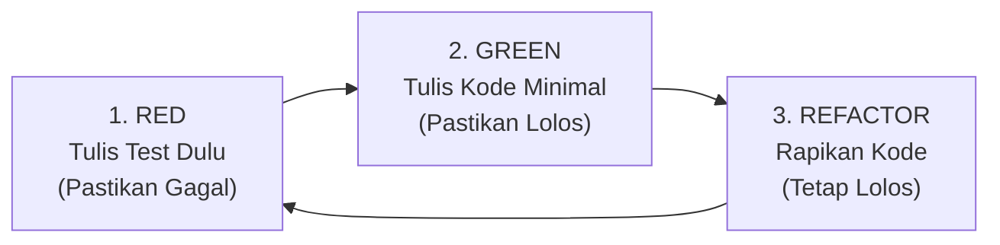

# Protokol & Aturan TDD untuk AI Coding Agent

Dokumen ini adalah **panduan mutlak (*non-negotiable rules*)** bagi AI Coding Agent dalam mengimplementasikan proyek **Qentral**. Agen diwajibkan mengikuti metodologi **Test-Driven Development (TDD)** secara ketat tanpa pengecualian.

---

## 1. Siklus TDD: Red - Green - Refactor

Setiap fitur, fungsi, atau perbaikan bug **WAJIB** melalui tiga tahap berikut secara berurutan:



### Tahap 1: RED (Test First)
1. Buat file test di direktori `tests/` sesuai pemetaan di `TEST_PLAN.md`.
2. Tulis skenario pengujian dengan ekspektasi yang jelas menggunakan `bun:test`.
3. **Eksekusi di terminal**: Jalankan perintah `bun test <path-file-test>`.
4. **Verifikasi Kegagalan**: Pastikan tes **GAGAL** karena fungsi/fitur memang belum ada, bukan karena syntax error atau salah import.
5. Laporkan output kegagalan tes tersebut sebelum melanjutkan.

### Tahap 2: GREEN (Make It Pass)
1. Tulis kode implementasi di direktori `src/` **seminimal mungkin** hanya agar tes tersebut berhasil lolos.
2. Hindari membuat fitur tambahan yang tidak diuji oleh tes pada tahap ini (*Over-engineering*).
3. **Eksekusi di terminal**: Jalankan kembali `bun test <path-file-test>`.
4. **Verifikasi Keberhasilan**: Pastikan seluruh tes berubah menjadi **HIJAU / PASS**.

### Tahap 3: REFACTOR (Clean Code)
1. Tinjau kembali kode implementasi: hilangkan duplikasi, perbaiki penamaan variabel, dan pastikan tipe data TypeScript akurat.
2. **Eksekusi di terminal**: Jalankan `bun test` untuk memastikan refactor tidak merusak fungsi yang sudah lolos.

---

## 2. Larangan Mutlak untuk AI Coding Agent

❌ **DILARANG** menulis atau mengubah file di dalam `src/` sebelum tes terkait dibuat di `tests/`.  
❌ **DILARANG** membuat *dummy test* yang selalu lolos tanpa validasi riil (misal: `expect(true).toBe(true)`).  
❌ **DILARANG** mengabaikan atau men-skip tes yang gagal (`test.skip` atau `it.skip`).  
❌ **DILARANG** mengubah ekspektasi pada file test agar cocok dengan implementasi yang salah/cacat.  
❌ **DILARANG** menyelesaikan tugas tanpa menyertakan bukti log eksekusi `bun test`.

---

## 3. Standar Pengujian di Lingkungan Bun

### A. Menggunakan Test Runner Bawaan Bun
Selalu gunakan library bawaan `bun:test`:
```typescript
import { describe, it, expect, beforeEach, mock, spyOn } from 'bun:test';
```

### B. Menguji Endpoint Hono Tanpa Membuka Port Jaringan
Untuk menguji route API Hono, **jangan jalankan server HTTP fisik**. Gunakan method `app.request()` bawaan Hono:

```typescript
import { describe, it, expect } from 'bun:test';
import app from '../../src/server';

describe('POST /api/v1/jobs/:queueName', () => {
  it('harus menolak request tanpa API Key dengan 401', async () => {
    const res = await app.request('/api/v1/jobs/email-queue', {
      method: 'POST',
      headers: { 'Content-Type': 'application/json' },
      body: JSON.stringify({ jobName: 'test', data: {} })
    });

    expect(res.status).toBe(401);
    const json = await res.json();
    expect(json).toHaveProperty('error');
  });
});
```

### C. Isolasi Unit Test & Mocking Redis
* Untuk **Unit Test**, gunakan mock antrean (*mocking*) atau `ioredis-mock` agar tes dapat berjalan mandiri, cepat, dan tidak bergantung pada Redis server yang sedang menyala.
* Untuk **Integration Test**, pastikan ada pembersihan (*teardown / cleanup*) antrean di `afterEach` atau `afterAll` agar tes tidak saling mempengaruhi.

---

## 4. Format Laporan Wajib AI Agent

Setiap kali AI Agent menyelesaikan satu siklus fitur/tugas, agen **wajib** melaporkan progres dengan format:

```markdown
### Progres TDD: [Nama Fitur / Skenario]

1. **Fase RED**:
   - File Test: `tests/...`
   - Output `bun test`: `1 failed, 0 passed` (Sertakan potongan error log)
2. **Fase GREEN**:
   - File Implementasi: `src/...`
   - Output `bun test`: `1 passed, 0 failed` (Sertakan log sukses)
3. **Fase REFACTOR**:
   - Perubahan: [Penjelasan pembersihan kode jika ada]
   - Status Akhir: `All tests passed`
```
